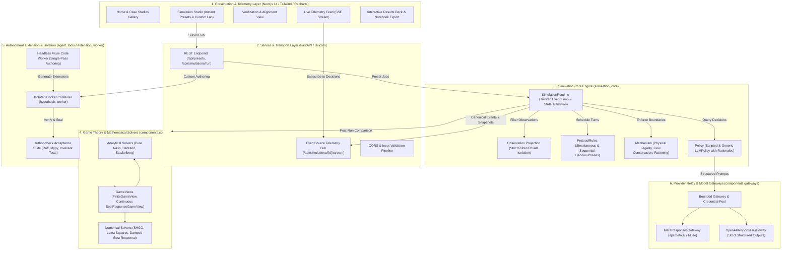

# Technical Architecture

Hypothesis is built as a modular, layered simulation system designed to bridge game-theoretic rigor with empirical LLM behavioral reasoning:



### Architectural Subsystems

#### 1. Client / Presentation Layer (`web/`)
* **Cybernetic Research Lab Aesthetic**: High-contrast obsidian (`#090D16`), electric cyan accents, translucent frosted glass cards, and crisp typography.
* **Instant Presets & Custom Simulation Studio**: Users can test verified microeconomic models (Supply Chain flood bottleneck, Differentiated Bertrand, Literary Panel Reception) or author unscripted experiments.
* **Live SSE Telemetry**: Subscribes to `/api/simulations/{id}/stream` to render turn-by-turn actor thought processes, bids, and market transitions in real-time.
* **Interactive Results Deck**: Dynamic KPI scorecards, interactive Recharts graphs, filterable decision inspector, and one-click Jupyter Notebook (`.ipynb`) and canonical event trace (`events.jsonl`) downloads.

#### 2. Service & Transport Layer (`src/web/`)
* **FastAPI Backend**: Provides lightweight, asynchronous REST endpoints for scenario alignment, job dispatching, and result queries.
* **Non-Blocking Streaming Engine**: Uses an async event queue (`JOBS[job_id]["events"]`) to push chunked Server-Sent Events to connected browsers as actors commit turns.
* **Sanitized Error Handling**: Strips host paths, internal stack traces, and API credentials before returning client diagnostics.

#### 3. Simulation Core Engine (`src/simulation_core/`)
* **`SimulationRuntime`**: Owns public state, phase/tick commits, and private memory updates. Implements the immutable trusted execution loop.
* **`Observation` Projection & Information Boundaries**: Projections are constructed from per-actor configuration permissions. World state contains public facts and owner-specific private facts/memory. Actors never observe another actor's private state, private instructions, or uncommitted actions.
* **`ProtocolRules`**: Manages scheduling mechanics. Supports simultaneous action rounds as well as multi-phase sequential commitment protocols (`DecisionPhase`).
* **`Mechanism`**: Validates physical and economic legality, enforces conservation laws (material balances, financial conservation, transport delays), resolves rationing/allocations, and computes payoff outcomes.
* **`Policy` & Decision Rationales**: Policies receive filtered observations and return one typed, schema-valid action per turn. Every LLM response is required to emit a concise, stated natural-language rationale explaining its decision logic.

#### 4. Game-Theoretic & Numerical Benchmarking (`src/components/solvers/`)
* **Separation of Benchmarks from Actor Decisions**: Mathematical benchmarks are calculated independently from actor reasoning; they serve as diagnostic reference ceilings rather than prescriptive controls.
* **Analytical Solvers**: Exact closed-form solutions for pure-strategy Nash equilibria, homogeneous Bertrand market clearing, and backward induction for two-stage Stackelberg leaders.
* **Numerical Solvers**: Solvers for nonlinear or differentiated demand structures (e.g. multi-segment logit choice) utilizing bounded least squares, local scalar minimization, and simplicial homology global optimization (SHGO).
* **Method Contracts**: Every solver declares explicit mathematical preconditions and applicability limits, preventing false claims outside domain assumptions.

#### 5. Autonomous Extension & Container Isolation (`src/extension_worker/`, `src/agent_tools/`)
* **Single-Pass Authoring**: Headless coding workers (`MODEL_CODING` with max reasoning) translate unstructured user problem descriptions into executable simulation extensions.
* **Container Isolation**: Generated experimental code lives strictly in `experimental_components/<experiment_id>/<version>/` and is executed exclusively inside an isolated Docker container (`hypothesis-worker`). Generated code is never imported or executed on the host.
* **`author-check` Validation**: Rigorous automated pipeline validating Ruff linting, Mypy static typing, unit tests, privacy boundaries, conservation invariants, and benchmark consistency.

#### 6. Model Gateways & Credential Pool (`src/components/gateways/`)
* **Bounded Model Gateways**: Enforces hard caps on request/response payload sizes, timeouts, and output tokens.
* **Strict Schema Outputs**: Emits and validates strict JSON Schema definitions for structured model output.
* **Host Key Leasing**: Host dynamically discovers `API_KEY` and any numbered auxiliary keys (`API_KEY_2`, `API_KEY_3`), leasing credentials to concurrent actors while keeping keys strictly isolated from manifests and trace logs.

---

## Shared Interfaces and Runtime Contracts

Open `visualisations/purestrategy.ipynb`, `bertrand.ipynb`,
`differentiated_bertrand.ipynb`, or `stackelberg.ipynb` with the project's `.venv`
Python kernel. The saved notebooks contain live LLM results, independent benchmark
comparisons, action explanations, provenance, and configured assumptions. Their
`USE_LIVE_API` switch enables deterministic fake gateways for offline verification.

The shared interfaces are explicit abstract parents:

- `simulation_core.policy.Policy`: observation requirements and a typed decision.
- `simulation_core.mechanism.Mechanism`: config/state/action validation, pure
  evaluation, and domain transition proposals.
- `simulation_core.protocol.ProtocolRules`: actor scheduling, batch legality,
  phase progression, and termination.

`SimulationRuntime` implements the trusted loop. Observations are constructed by
`simulation_core.observation` from per-actor configuration permissions, independently
of scheduling and mechanism code. Actors receive only configured public fields and
their own configured private fields/memory. Permissions select top-level fields;
an allowed field exposes its nested contents. Defaults expose no public/private
facts, while permitting each actor to read and replace its own memory. Policies
may also propose allowed own-private-fact patches. The runtime owns public state,
phase/tick commits, and private updates. Mechanisms may propose private record
replacements (for example, exposure delivery); conflicting mechanism/policy edits
to the same private record fail explicitly. Outcomes may contain no payoffs or
payoffs for a subset of actors; mechanisms enforce domain-specific completeness.

`components.library.standard_registry()` provides approved factories. Its
`describe()` method exposes IDs, parameter schemas, and action schemas as JSON.
Factories create fresh components per run and fresh policies per actor. Arbitrary
module loading is not supported. Mypy checks concrete components against the
abstract parent contracts.

Experiment-specific data is separate from components:

- `src/examples/configs/prisoners_dilemma.json`: actors, action schemas, scripted
  choices, payoff cells, visible state, assumptions, and round count. Expected
  payoffs for A cooperating/B defecting: A=0, B=5.
- `src/examples/configs/measurements.json`: three numeric measurement actors,
  configured private updates, two recording rounds, and metric-only outcomes.

The normal-form mechanism supports arbitrary actor IDs, any positive number of
actors, asymmetric finite choices, explicit payoff cells, and configurable output
fields. The recording mechanism collects arbitrary schema-validated actions.
The simultaneous protocol and scripted policy have no experiment-specific fields.
Tests also cover an asymmetric three-player normal-form game and an active-actor
subset, alongside privacy, validation, replay, mutation, and isolation checks.

To add an experiment, inspect the registry, populate `SimulationConfig` JSON, and
run it through the same runtime. If a component is missing, implement the relevant
abstract parent, register its trusted factory and schemas, and test it without
changing the runtime. There are no hidden textbook defaults in the core; any
experiment-building defaults must be recorded in configuration assumptions.

Internal event snapshots are the canonical committed record and include private
state; never provide them to actors. Replay makes no policy or mechanism calls.
M1 logging is in-memory, and the local runner is for trusted components. Durable
storage, redacted export, stochastic mechanisms, and isolated untrusted extensions
remain future milestones.


User requests and temporary jobs
-------------------------------

`ExperimentRequest` is the Pydantic contract for an incomplete user hypothesis,
supplied inputs, and requirements. A creating agent resolves it into the separate
`SimulationConfig`. The contracts do not yet perform natural-language compilation.
Component parameters are validated against registered Pydantic models. The registry
also exposes request and resolved-config JSON schemas for agent discovery.

`Assumption` records an exact JSON Pointer, value, source, rationale, and optional
reference. Validation rejects stale values, missing paths, and duplicate paths.
`JobManifest` binds request to config and verifies supplied inputs that have explicit
target paths. Free-text requirements and unmapped inputs require agent interpretation.

```python
from components.library import standard_registry
from simulation_core.execution import JobRunner, LocalBackend
from simulation_core.request import ExperimentRequest

request = ExperimentRequest(hypothesis="What happens under these choices?")
# config is a fully resolved SimulationConfig, authored with registered schemas.
artifact = JobRunner(LocalBackend(standard_registry())).run(request, config)
# artifact.manifest retains request/config; artifact.result contains outcomes/events.
```

The runner serializes a versioned job manifest into a temporary directory, executes,
and deletes the directory on success or failure. It does not persist results/configs.
The returned in-memory artifact retains provenance and can be explicitly exported.
`examples.payoff_matrix.run_job()` demonstrates this path; `run_experiment()` returns
only its RunResult for convenience. Checked-in config/request JSON files remain
stable test fixtures. Full artifacts include private data and require restricted access.
LocalBackend is trusted in-process execution, not a security sandbox. Future isolated
workers should preinstall the core/approved library and accept job manifests; arbitrary
extensions require a separate isolated code bundle and must not run in LocalBackend.

LLM policies and mathematical benchmarks
---------------------------------------

`LLMPolicy` implements Policy and uses an injected `ModelGateway`. Its bounded
request contains only configured instructions/persona, the actor's authorized
observation, and its declared action payload schemas. Responses must supply one
schema-valid action, optional own-memory replacement, permitted private patches,
and a required nonempty concise rationale. Generic JSON updates travel as key/value_json
entries so strict provider schemas need no open-ended objects. Duplicate keys,
nonfinite values, impersonation, malformed JSON, and disallowed writes are rejected.
Runtime independently checks action ownership, schemas, domain legality, and writes.
There is no hidden conversation state; only committed private memory is resupplied.

A shared per-job BoundedGateway limits calls, request/response sizes, and output
tokens per call. LLMPolicy separately bounds attempts and calls per actor. These
are call/token limits, not a dollar-price estimate. Provider transport has a timeout
and no hidden retries. Committed events and RunResult retain prompt/response call
records, provider request IDs, actual/requested model IDs, and usage. Failed
LLM decisions raise LLMPolicyError with the failing policy's call records and do not
commit an incomplete action batch. Replay never invokes a gateway.

`Solver` and `GameView` are general mathematical interfaces. PureNashSolver uses
only a finite read-only GameView. NormalFormGameView adapts the selected mechanism
without duplicating payoff equations. The solver has a profile budget and payoff
tolerance; it reports solved, multiple, no_pure_equilibrium, or budget_exhausted.
It makes no claim about mixed equilibria. Every equilibrium is retained.

BenchmarkSpec explicitly selects solver/view/parameters and the compared tick
(default: final committed tick), with a complete-information assumption. BenchmarkRunner
uses an isolated copy of that tick's precommit state. JobResult.benchmark contains
all equilibrium comparisons, actor-minus-equilibrium payoff deltas, action
differences, unilateral deviation gains (regrets), and a config SHA-256. Expected
benchmark failures report separately from the primary actor run; programming errors
propagate for diagnosis. No benchmark action replaces an actor action.

Offline demonstration:

```python
from examples.llm_payoff_matrix import run_llm_job
artifact = run_llm_job()  # generic LLMPolicy, deterministic FakeGateway; zero API calls
print(artifact.benchmark.result.status)
print(artifact.benchmark.comparisons[0].payoff_deltas)
```

The fixture chooses cooperate/defect: payoffs (0, 5), compared with the unique
pure-Nash defect/defect payoffs (1, 1). Deltas are (-1, +4); regrets are (1, 0).
Fake and live modes are explicitly labeled in call records and the notebook.

Live test setup:

1. Set API_KEY and MODEL in the project .env (or environment); OPENAI_API_KEY and
   OPENAI_MODEL remain supported aliases. The model
   is explicit; no provider/model is selected silently and no credentials go into
   manifests, actor configuration, source files, or notebook cells.
2. In the notebook set USE_LIVE_API = True and rerun. Or call
   `examples.llm_payoff_matrix.run_live_job()` from Python.
3. Optional live pytest: `RUN_LIVE_LLM_TEST=1 uv run pytest tests/test_llm_policy.py -k live`.
   The ordinary suite skips it and mocks all provider calls.

The OpenAI and Meta adapters use Responses API structured output with strict JSON Schema,
refusal/incomplete handling, no response storage request, and bounded HTTP reads.
See [official OpenAI documentation](https://developers.openai.com/api/docs/guides/structured-outputs?api-mode=responses).
Generic policy/gateway contracts do not depend on OpenAI. Registration of llm.v1
requires an injected gateway; the default registry has no network-enabled policy.
The job helper creates a fresh shared bounded gateway per run. Execution remains
trusted and in-process; model adapters do not provide untrusted-code isolation.


Per-action explanation traces and the live Contributor run
---------------------------------------------------------

Every LLM response must include a nonempty, concise stated decision rationale;
null/blank explanations are retried and rejected within the normal call budget.
This is the model's stated explanation, not its private internal reasoning.
Decision.rationale is retained in each Event.decisions record and linked to the
accepted ModelCallRecord.rationale. Replay checks action/rationale links and never
recalls the model. ScriptedPolicy reports that it emitted a configured action.

The runtime emits one JSON logging entry per committed action to simulation.actions.
Use stream_action_trace() to enable console output; traces remain in events even
when console logging is disabled. The notebook enables streaming and prints a
per-turn explanation table after execution.

LiveModelSettings loads API_KEY/MODEL from the nearest project .env, including when
a notebook runs from visualisations/. Explicit process environment takes precedence,
and the optional model argument overrides MODEL. Credential serialization is excluded.
Muse model IDs select the MetaResponsesGateway at api.meta.ai; other models retain
the OpenAI adapter. The generic LLMPolicy is unchanged across providers. For Muse,
the example explicitly records low reasoning effort in its policy config.
See [Meta's API overview](https://dev.meta.ai/docs/overview),
[structured output](https://dev.meta.ai/docs/structured-output), and
[reasoning settings](https://dev.meta.ai/docs/reasoning).

The saved notebook is now a LIVE muse-spark-1.3-contributor run: A and B both chose
defect and received payoff 1, matching the unique pure equilibrium. Both explained
that defect yields a greater own payoff for either rival move. These are actual
model responses; the older fake-gateway cooperate/defect result was hardcoded only
inside examples.llm_payoff_matrix.fake_response. Flip USE_LIVE_API to False for
that deterministic fixture; leaving it True makes billed API calls on re-execution.


Homogeneous Bertrand experiment (M2.2 first increment)
----------------------------------------------------

`visualisations/bertrand.ipynb` compares live LLM prices, quantities, and profits
against a certified textbook Bertrand–Nash equilibrium, with per-action rationales,
continuous deviation-gain diagnostics, model-call metadata, and canonical replay.
It is live by default; set USE_LIVE_API=False for the off-equilibrium fake fixture.
The existing finite-game notebook is preserved separately.

```python
from examples.bertrand import BertrandExampleSettings, run_job, run_live_job
settings = BertrandExampleSettings(a=100.0, b=1.0, marginal_cost=20.0,
                                   price_lower=0.0, price_upper=100.0)
artifact = run_job(settings)       # offline fake gateway: prices 30 and 25
# artifact = run_live_job(settings)  # model and key from .env
```

The settings class creates a typed SimulationConfig; only temporary job JSON is
written. Defaults are illustrative assumptions, not estimated market data. Both
firms see Q(P)=max(a-bP,0), their own piecewise demand, both constant marginal costs,
price bounds, and the timing/supply rules. The lower price captures all demand;
exact ties split it equally. Prices are continuous, not rounded to cents. Selling
below cost is allowed and correctly produces losses. Demand above the choke price
is zero. Unlimited capacity and no fixed costs are explicit assumptions.

Reusable economic interfaces live in simulation_core/economics.py: aggregate
DemandModel, CostModel, ProfitModel, and AllocationRule. Components implement
LinearDemand, ConstantMarginalCost, RevenueMinusCost, and LowestPriceAllocation.
HomogeneousBertrandMechanism composes these and validates price actions, actor
references, domain bounds, state history and outcome consistency. The allocation
contract enforces nonnegative quantities and conservation. The mechanism supports
arbitrary firm IDs and at least two firms; the textbook benchmark deliberately
certifies only two identical-cost firms with positive demand at feasible cost.
The trusted runtime and generic LLMPolicy have no Bertrand-specific branches.

GameView now separates finite enumeration (FiniteGameView) from a continuous
best-response oracle (BestResponseGameView). PureNashSolver still enumerates finite
games; TextbookBertrandSolver derives p_A=p_B=c and independently checks unilateral
profit gains through a region-wise oracle using the mechanism's primitives. This
is a Nash equilibrium, not monopoly/joint-profit maximization. The continuous
benchmark has no finite profile count or numerical grid-convergence claim.

Against some rival prices above cost, a firm can approach its best payoff by
undercutting arbitrarily closely but no price attains it. BestResponseResult then
reports a supremum, attained=False, no maximizing action, and a feasible nearby
witness with its actual payoff. The gain is a supremum of unilateral improvement,
not a claim that the witness achieves a mathematical maximum. Exact tie, strictly
lower price, monopoly optimum, and zero-sales branches are evaluated separately.

The analytical certificate reports unsupported outside its declared assumptions
(e.g. asymmetric costs, a binding price floor above cost, or zero demand at cost).
It does not claim that no equilibrium exists. Actor runs retain their independent
status. Shared benchmark comparisons now include numeric action deltas and scalar
metric deltas, as well as full observed/equilibrium outcomes and payoff differences.

Acceptance tests cover piecewise allocation/profits, zero-demand truncation,
exact ties, losses below cost, own-price demand monotonicity, invalid price/schema
rejection before transition, fresh worlds, evaluation purity, analytical results
across parameters, supremum nonattainment, independent dense-grid lower checks,
arbitrary IDs/multifirm allocation, privacy, simultaneous observations, rationales,
canonical replay, benchmark purity, and explicit unsupported cases. Dense grids
are tests/illustrations only; they do not define the benchmark or its price domain.
Differentiated Bertrand remains deferred until requested.


Saved Bertrand live result: muse-spark-1.3-contributor independently chose price 20
for each firm. Each sold 40 units and earned zero profit, exactly matching the
separate analytical benchmark. Both first-attempt responses included rationales.
This is one synthetic model run, not a calibrated market prediction.


Differentiated Bertrand with user inputs
---------------------------------------

Open `visualisations/differentiated_bertrand.ipynb`. Its editable input cell uses
`DifferentiatedBertrandInputs`, `FirmInput`, and `ConsumerSegment` Pydantic classes.
Replace the illustrative numbers and set INPUT_SOURCE="user", or deserialize a
user input with `DifferentiatedBertrandInputs.model_validate_json(...)`. Required
costs, bounds, populations, price sensitivities, and per-firm utilities are not
invented. An omitted outside utility defaults to zero and is explicitly recorded.
Utilities are dimensionless; price sensitivities are per price unit. Consumer
segments are aggregate demand parameters, not separate LLM survey respondents.

```python
from examples.differentiated_bertrand import (
    DifferentiatedBertrandInputs, FirmInput, ConsumerSegment, run_job, run_live_job,
)
from components.mechanisms.bertrand import PriceDomain

inputs = DifferentiatedBertrandInputs(
    firms=(FirmInput(id="A", marginal_cost=1.0, price_domain=PriceDomain(upper=10.0)),
           FirmInput(id="B", marginal_cost=1.2, price_domain=PriceDomain(upper=10.0))),
    segments=(ConsumerSegment(id="customers", population=300.0,
                 price_sensitivity=1.0, utilities={"A": 3.0, "B": 3.2}),),
)
artifact = run_job(inputs)       # fake model, real numerical benchmark
# artifact = run_live_job(inputs)  # credentials/model from .env
```

The user-input compiler records mapped supplied values in ExperimentRequest and
creates the validated SimulationConfig; job manifests are temporary. Numeric
illustrations are marked as defaults. Model assumptions, outside-option
normalization, numerical tolerances, and information defaults are separately
recorded. A complete per-firm permissions mapping can override complete public
information. The mathematical benchmark still assumes complete information; a
restricted actor's deviations do not, by themselves, establish irrationality.

Reusable DemandSystem and DifferentiableDemandSystem parents accept a joint price
profile. SegmentedLogitDemand computes shares using maximum-centered exponentials,
including the outside option in normalization. Each segment's shares sum to one;
firm quantities plus outside quantity conserve population. Costs/profits, price
schemas, protocols, LLM policies, traces, and execution infrastructure are reused.
The mechanism owns demand/profit calculations and their own-price derivatives;
optimizers never copy these economic equations.

DifferentiableScalarGameView is a solver-facing capability for one bounded scalar
action per player. NumericalNashSolver is independent of logit or Bertrand: it uses
multistart bounded projected-gradient roots, then checks payoff deviations with
uniform/geometric samples and local refinements plus independent SHGO searches.
If roots fail, a bounded damped best-response fallback is attempted. Each objective
has a hard evaluation budget. All distinct candidates found are retained, with
payoff/price tolerances, method attempts, residuals, gains, and price-bound flags.
`certification="numerical"` marks both solver and best-response results. These
best-found values are estimates, not rigorous global-optimality certificates.
A single found candidate is not a proof of uniqueness; failure/budget exhaustion
is not a proof that equilibrium does not exist. Primary actor runs remain separate.

The input class exposes typed benchmark settings for tighter tolerances or larger
search budgets. Prices beyond feasible bounds, invalid dimensions, duplicate IDs,
nonpositive sensitivities/populations, and nonfinite data fail validation. Extreme
utilities are handled without exponent overflow. JSON-transport validation now
handles tuple-backed Pydantic array fields correctly, without relaxing scalar types.

The notebook shows editable inputs, primary LLM prices/rationales, every found
numerical comparison, prices/quantities/profits, segment/outside shares, search
qualifications, call metadata, replay, and assumptions. It makes bounded live calls
by default (two firms, at most two attempts each, 4,000 output tokens per response).
Set USE_LIVE_API=False for offline execution. The illustrative data is not a
calibrated empirical market or a prediction of human behavior.

Numerical API references: [bounded least squares](https://docs.scipy.org/doc/scipy/reference/generated/scipy.optimize.least_squares.html),
[local scalar minimization](https://docs.scipy.org/doc/scipy/reference/generated/scipy.optimize.minimize_scalar.html),
and [SHGO](https://docs.scipy.org/doc/scipy/reference/generated/scipy.optimize.shgo.html).


Saved differentiated live result (illustrative inputs): muse-spark-1.3-contributor
chose prices A=2.30 and B=2.50. The retained numerical Nash candidate prices are
approximately A=2.349056 and B=2.528764, with per-firm unilateral gain checks around
1e-13 at the candidate. Estimated unilateral gains at the LLM profile are about
0.328590 and 0.031705. Model actions remain primary and are not overwritten.

An initial live attempt returned an incomplete response at the shorter budget.
The differentiated example now explicitly uses minimal reasoning effort and a
4,000-token response cap, with at most two attempts per firm. Incomplete responses
retain sanitized reason, request ID, and token usage; rejected attempts are emitted
as structured diagnostic log entries. Only accepted, fully validated batches commit.
The successful saved run used one accepted request per firm. No private internal
reasoning is requested or exposed; the visible rationale is the model's stated
explanation. Credential values are excluded from configuration and notebook outputs.


Component layout
----------------

```text
src/components/
  common/
    economics/
      models.py             # Linear demand, costs, profit, lowest-price allocation
      segmented_logit.py    # Differentiated demand system and segment schema
    math/
      scalar.py             # Bounded scalar optimization, budgets and diagnostics
  mechanisms/
    normal_form.py          # Parameters, mechanism, and NormalFormGameView
    bertrand.py             # Parameters, mechanism, and BertrandGameView
    differentiated_bertrand.py  # Parameters, mechanism, and its game view
    stackelberg.py          # Quantity schema, two-stage mechanism, and game view
    recording.py
  solvers/                  # Game-level solution concepts and search procedures
  policies/
  protocols/
  gateways/
  library.py
```

A mechanism and its corresponding solver view are co-located, retaining separate
classes and interfaces. Mechanisms evaluate consequences and propose transitions;
game views expose isolated solver-facing capabilities; SimulationRuntime owns the
execution loop and commits. User-run values and actor instructions remain typed
configuration. The former components.games package is removed.

The common parent groups reusable implementations with explicit purposes rather
than a catch-all utilities module: economics contains domain models and allocation
rules, while math contains numerical routines that know nothing about actors or
economic assumptions. Game-theory solvers stay in solvers because they implement
solution concepts using game views. Abstract economic and solver contracts remain
in simulation_core. Component IDs and JSON job formats are unchanged. Restart
existing notebook kernels after updating imports; saved live outputs are preserved.


Sequential phases and Stackelberg (M3)
-------------------------------------

`SequentialProtocol` consumes typed `DecisionPhase` entries: each phase names its
active actors, who each act exactly once. A phase may contain multiple actors, and
an actor may participate in later phases. Scheduling has no market-specific logic.
`SimulationConfig.phase_permissions[phase][actor]` replaces that actor's base
permission object for the selected phase; missing overrides use base permissions.
Unknown actor/phase references fail before actor calls. Observation projection
remains trusted runtime code, and private state remains isolated per actor.

`SequentialGameView` assembles a comparison profile from a declared sequence of
committed stages, recording each action's source tick. `TwoStageGameView` adds a
selected optimal follower continuation and separately interprets leader/follower
deviations. The current profile adapter covers one episode; it rejects missing or
reordered stages. A partial run can retain a theoretical solution while its
comparison is explicitly incomplete. It never invents missing actor actions.

`examples.stackelberg.StackelbergInputs` accepts inverse demand, leader/follower
identities, nonnegative constant costs, bounds, and optional personas. The example
uses `sequential.v1`, `stackelberg.v1`, the existing `llm.v1` policy, and the existing
canonical event recording/job runner. The mechanism records an irreversible leader
commitment, then clears the market after the follower commits. The follower sees
the actual leader quantity through its phase permissions. Shared inverse demand,
cost, and profit implementations live in `components.common.economics`.

`backward_induction.v1` is currently the exact bounded linear Stackelberg solver,
not a general extensive-form tree solver. It uses the bounded follower response
and piecewise quadratic leader optimization, including asymmetric costs, binding
bounds, shutdown, forced losses, and zero-price ties. Results are marked
`subgame_perfect`, with a minimum-quantity follower tie rule. Maximizing candidate
actions and any optimal zero-profit intervals are retained; this does not enumerate
every follower strategy possible under alternative tie choices.

The follower diagnostic is its conditional improvement at the observed leader
quantity. The leader diagnostic compares rational continuations, rather than
holding the observed follower quantity fixed. Actual leader profit can exceed the
benchmark if the LLM follower responds poorly. One trajectory does not identify an
LLM's full contingent strategy.

`visualisations/stackelberg.ipynb` includes editable Pydantic inputs, the stage
timeline and visible commitments, quantity/profit/price comparisons, follower
response and leader-profit curves, explanations for every action, and replay. Its
saved Contributor run chose quantities (40,20), price 40, and profits (800,400),
matching the analytical benchmark for a=100, b=1, and both costs=20. Each actor used
one accepted call. Live calls are capped at two attempts per actor. The offline
fixture deliberately chooses (30,20), demonstrating nonzero conditional gains and
the distinction between actual and anticipated leader profit.


Component compatibility and shared building blocks
-------------------------------------------------

`ComponentRegistry.validate_config()` now validates composition before actor
decisions. This also runs when SimulationRuntime is called directly. Mechanisms
declare supported action schemas per actor and scheduling requirements; protocols
can expose a static sequence of core `DecisionPhase` objects. Preflight checks
initial state, payload contracts, known schedules, initial required observations,
and permission coverage for later declared stages. It constructs the benchmark
view and checks the solver's required capability without solving the game or
calling a policy. `describe()` exposes solver capability requirements. Incompatible
combinations raise `ComponentCompatibilityError` with the reason.

Payload compatibility is conservative structural JSON Schema equality, ignoring
the model's display title; it does not infer arbitrary schema subtyping. A
mechanism may declare different schemas for different actors, or leave an actor
open to registry-validated payloads, as RecordingMechanism does. Dynamic protocols
may return no static schedule; their later state-dependent legality remains a
runtime check. Structural compatibility does not establish the economic
assumptions of a particular theorem: analytical solvers still return `unsupported`
for compatible views outside their theorem's scope.

`DemandSystemResult` contains general nonnegative finite quantities. The
segmented-share and outside-population conservation contract now lives in
`components.common.economics.segmented_logit.SegmentedDemandResult`. Other demand
systems do not need to invent consumer segments or an outside option.

`simulation_core.domains.ScalarInterval` supports finite ordered coordinates,
including negative values. PriceDomain and QuantityDomain add their own
nonnegative restrictions. `simulation_core.analysis.AnalysisResult` is an
extensible result envelope with no implied equilibrium or certification;
SolveResult remains its game-equilibrium specialization. This does not change the
existing equilibrium benchmark runner into a universal analysis orchestrator.

Numerical settings use `action_tolerance`; old `price_tolerance` inputs remain
accepted. ScalarMaximum serializes `objective_value`, accepts old `payoff` JSON,
and retains a read-only `payoff` accessor. Numerical best responses expose
`estimated_best_payoff` and a feasible `witness_action`; `supremum_payoff`,
`attained`, and `maximizing_action` are unset when the search cannot certify them.
Analytical Bertrand responses retain certified suprema and attainment distinctions.

`components.solvers.response` shares unilateral-objective construction and scalar
search across game views, numerical Nash verification, fallback, and observed
benchmark diagnostics. The numerical solver supplies the same configured search
settings to each path. Independent numerical cross-checks remain distinct.
`MechanismGameView` shares snapshot-isolated evaluation; registry policy creation,
permission lookup, and initial snapshots are also shared. `components.jobs.run_model_job`
centralizes the examples' bounded gateway and trusted job setup; live provider
selection uses the existing configured_gateway helper throughout. Defensive
copies, canonical snapshots, actor-specific private state, and execution-boundary
revalidation remain in place.


Method assumptions and applicability
------------------------------------

Solvers now expose typed method contracts listing requirements, conditional
guarantees, and limitations. Registry discovery includes `solver_contracts`;
`registry.benchmark_applicability(config)` assesses the selected method without
actor calls or a solver search. Every built-in solver result retains an
`applicability` report. Scalar numerical searches expose the same contract
mechanism. Required false or unverified conditions block execution; unresolved
conditional assumptions remain visible without being promoted to proofs.

See [the method contract guide](docs/method_contracts.md) for the audited current
methods, APIs, evidence levels, and future convex-method examples. Solver
extensions implement `_solve` under the shared public precondition-checking
`solve` template. Positive numerical samples do not establish global convexity.


External coding-agent tools and isolated extensions
--------------------------------------------------

`agent_tools` supplies typed gap/spec contracts, capability inventory, immutable
versioned bundle sealing, and Docker validation/execution tools for an external
coding agent. Experimental code remains outside src, in
`experimental_components/<experiment>/<version>`. It is never imported on the
host or added automatically to the global registry. Docker sbx's private engine
is supported through `--sandbox`; ordinary Docker is supported without it.

See [the experimental workflow](docs/experimental_workflow.md) and
[prompts/newsimulation.md](prompts/newsimulation.md). The retained vector-allocation
trial demonstrates a vector decision with a coupled budget constraint, a separate
analytical optimum, contract tests, and actual worker restrictions.

`ExperimentRequest.problem` now accepts a typed numeric problem with scalar/vector
variables, objectives, and constraints; see [structured problems](docs/problem_statements.md).
The optional `CodingAgent` adapter injects [its system instructions](prompts/blind_coding_agent.md)
and a curated source inventory into auditable API calls, without exposing
old experiment bundles. The [first live coding trial](experimental_components/allocation_trial/TRIAL.md)
made five actual model calls and failed validation; it is retained as a failed
submission, with no claimed simulation result.

The [next-trial preparation](docs/authoring_preparation.md) adds pre-freeze plan
and test checks, problem-derived verification, an agent-authored notebook
generator, and an opt-in workflow with no default coding-turn or repair cap.
The retained [fresh allocation trial](experimental_components/allocation_live_8f8bf161/TRIAL.md)
documents the later live failure and its lessons. Current authoring uses native
Pydantic plan/config objects, structured review outcomes and optional behavioral
checks. [Task routing](docs/task_routing.md) distinguishes direct callable tools
from LLM-agent simulations. Coding uses MODEL_CODING (muse-spark-1.3, max reasoning);
simulation actors retain MODEL (muse-spark-1.3-contributor). These latest changes
have been tested offline; the proposed auction has not been run.