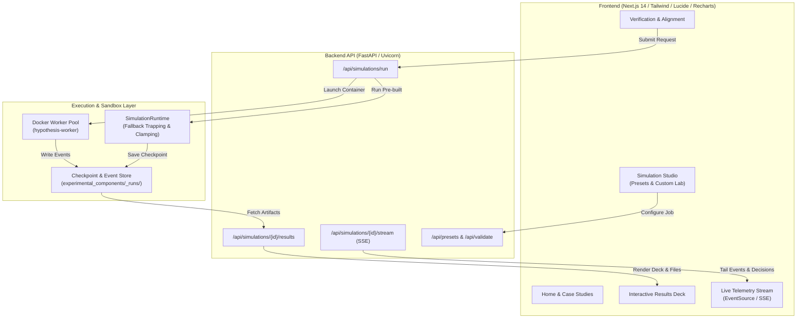

# Web Interface Architecture & Design Specification

This document specifies the layout, user experience, aesthetic theme, and backend integration for the **Hypothesis** simulation web platform.

---

## 1. Aesthetic Theme & Design System

### Style: "Cybernetic Research Lab"
The visual identity aligns with the name **Hypothesis**—a futuristic, high-precision computational economics and agentic simulation laboratory.

* **Color Palette**:
  * **Background**: Deep space obsidian (`#090D16`, `bg-slate-950`) with subtle radial gradients and low-opacity cyber gridlines.
  * **Surfaces & Cards**: Translucent dark slate (`#131B2E`, `bg-slate-900/80` with `backdrop-blur-md` and `border-slate-800`).
  * **Primary Accents**: Electric Cyan (`#06B6D4` / `#22D3EE`) and Neon Indigo (`#6366F1`) representing active intelligence and computation.
  * **Status & Telemetry**:
    * Success / Convergence: Emerald (`#10B981`)
    * Disruption / Constraint Active: Amber (`#F59E0B`)
    * Violation / Infeasibility: Rose / Crimson (`#F43F5E`)
* **Typography**:
  * Headings: Clean geometric sans-serif (`Inter` or `Space Grotesk`).
  * Telemetry, Tickers, and Rationale Quotes: Monospace (`JetBrains Mono` or `Fira Code`).
* **Micro-Interactions**:
  * Subtle glowing borders, pulsing execution badges, and smooth state transitions powered by Framer Motion.

This visual theme should extend to documents that it creates too, the created collaterals should not deviate sharply from this theme.

---

## 2. Navigation Architecture

Fixed top navigation bar across all views:
* **Top Left**:
  * **Hypothesis Logo**: Minimalist glowing node-network glyph + stylized "HYPOTHESIS" wordmark. Clicking routes to the **Home Page**.
* **Top Right**:
  * **Explore / Case Studies**: Navigates to showcase gallery with historical experiment replays.
  * **Simulate**: Primary CTA button with glowing cybernetic border. Directs to the **Simulation Studio**.
  * **Documentation / API**: Quick reference to computational primitives and game theory interfaces.
  * **Log In / Account**: Secondary button (shows status modal: *"Guest Sandbox Active — Authentication in progress"*).

---

## 3. Page Layouts & Workflows

### 3.1 Home Page
1. **Hero Section ("The Autonomous Behavioral Laboratory")**:
   * Headline: *"Decentralized Multi-Agent Simulations Powered by Autonomous Coding & Reasoning LLMs."*
   * Interactive live canvas: Ambient animated node network showing supply chain or pricing interactions in real time.
   * Primary Action: **"Launch a Simulation"** button.
   * Secondary Action: **"Explore Case Studies"** button.
2. **About / Value Proposition**:
   * Why Hypothesis exists: Bridging game-theoretic rigor, computational primitives (conservation, delayed transit, LP rationing), and unconstrained LLM behavioral reasoning.
   * When to use Hypothesis: Whenever you need a prediction for market feedback. Thrives especially in multi-agent, multi-turn scenarios. 
3. **Featured Showcase ("The Flood Disruption Experiment")**:
   * Teaser card showing the 9-day decentralized supply chain flood scenario.
   * Key visual: Comparative chart of decentralized vs. coordinated recovery with interactive tooltip preview.
   * CTA: *"Inspect Case Study"*.

---

### 3.2 Case Studies Gallery
Extends past experiments into an interactive gallery showcasing pre-computed and validated simulations:
* **Featured Scenarios**:
  1. *Decentralized Supply Chain Flood Disruption*: 4 organizations, 9 days, 80-unit transport bottleneck, bullwhip effect vs. inventory hoarding.
  2. *Differentiated Bertrand Pricing Competition*: Asymmetric consumer choice segments, Bertrand-Nash equilibrium vs. algorithmic tacit collusion.
  3. *Public Goods Free-Riding*: Linear voluntary contribution mechanism with social welfare degradation.
  4. *Second-Price Sealed-Bid Auction*: Revenue equivalence and dominant strategy equilibrium validation.
* **Per-Scenario Card Details**:
  * Summary executive abstract and theoretical game-theoretic benchmark.
  * 2 high-resolution interactive charts (Payoffs, Inventory/Price trajectory).
  * Direct download button for the reproducible `.ipynb` notebook and `result.json` raw artifact.
  * 1-click **"Re-run with Custom Parameters"** button that clones the configuration into the Simulation Studio.

---

### 3.3 Simulation Studio (`/simulate`)

The Studio provides two distinct creation pathways:

#### Pathway A: Instant Presets (Zero-Latency Execution)
* Designed for users who want immediate results (~15–30 seconds) without waiting for LLM code generation.
* User selects a verified scenario (Supply Chain, Bertrand Competition, Public Goods, Stackelberg).
* Interactive sliders adjust:
  * Number of rounds / horizon
  * Shock severity (e.g. transport disruption capacity)
  * Actor personas (e.g. "Risk-Neutral Profit Maximizer", "Cooperative Supplier", "Opportunistic Price Cutter")
* Clicks **"Run Simulation"** $\rightarrow$ Executes directly on the pre-compiled runtime.

#### Pathway B: Autonomous Laboratory (Muse Coding Agent Authoring)
* Designed for custom, unscripted user research questions.
* **Input Fields**:
  * **Experiment Hypothesis & Goal** *(Mandatory)*: High-level research objective.
  * **Horizon / Number of Turns** *(Mandatory)*: Discrete days/rounds.
  * **Actor Specifications** *(Mandatory)*: Number of actors, organization roles, and initial endowments.
  * **Turn Protocol & Sequence** *(Mandatory)*: What sequence of decisions occurs in a single round.
  * **Physical / Economic Constraints** *(Optional / AI-Assisted)*: Conservation rules, transport delays, budget caps.
  * **Behavioral Directives & Personas** *(Optional / AI-Assisted)*: Private motivations, risk tolerance, hidden information boundaries.

#### Container & Agent Lifecycle:
* **On-Demand Sandbox Execution**: Docker worker instances are spun up cleanly upon job submission rather than lingering on page visit, preventing server resource exhaustion.
* **Pre-warmed Container Image Pool**: The worker image (`hypothesis-worker`) remains cached on the host; container initialization takes $<1.5$ seconds.
* **Session Persistence**: An idle timeout of 20 minutes applies to active conversational authoring sessions before cleaning scratch volumes.

---

### 3.4 Verification & Alignment View (`/simulate/verify`)

Before code generation starts, an LLM Alignment Engine parses the user's raw prompt into a structured mathematical contract:
1. **Summary Readback**:
   * Structured breakdown of interpreted rules: Phases, Action spaces, Payoff functions, and State visibility.
2. **Explicit Assumptions Card**:
   * Bulleted list of modeling assumptions the agent has adopted (e.g., *"Transit delay is assumed to be 1 full day"*, *"Information between Supplier A and B is strictly private"*).
3. **Feasibility & Penalty Configuration**:
   * Configured constraint behavior: Displays whether requests exceeding feasible bounds are clamped automatically and whether an overage penalty is assessed.
4. **Simulation Schematic Preview Card** *(described in Section 5.1)*:
   * Displays the AI-generated isometric simulation diagram depicting the 1-round mechanism, actor layout, and decision thought bubbles to visually confirm alignment.
5. **Action Controls**:
   * **"Edit Requirements"**: Opens an in-place markdown editor to refine instructions. Includes versioning (tracks Edit 1, Edit 2; auto-locks after 3 rounds to avoid infinite conversational loops).
   * **"Approve & Execute"**: Validates the payload against `ExperimentRequest` (Pydantic) and dispatches the task to the backend worker.

---

### 3.5 Live Telemetry & In-Progress View (`/simulate/live/{job_id}`)

To eliminate the "black box" waiting experience during the 15-minute authoring and execution phases, this page provides a **Live Stream Feed** via Server-Sent Events (SSE):

* **Horizontal Phase Tracker**:
  1. `Synthesizing Protocol & Mechanisms` (Authoring candidate)
  2. `Automated Sandbox Verification` (Ruff, mypy, acceptance tests)
  3. `Live Simulation Execution` (Rounds 1..N with live actors)
  4. `Compiling Analytics & Report` (Rendering final notebook & figures)
* **Live Rationale & Decision Feed**:
  * Real-time streaming ticker displaying actor turns as they occur.
  * Example tile:
    ```
    [Day 4 | Phase: Make] Actor: Manufacturer
    Action: Produce 80 units
    Rationale: "Inventory of Component A is 96, Component B is 80. Demand is 80. Producing 80 maximizes revenue while avoiding holding penalties."
    ```

---

### 3.6 Interactive Results Dashboard (`/simulate/results/{job_id}`)

When the simulation completes, users receive an **Interactive In-Browser Deck** in addition to downloadable files:

1. **Executive Scorecard (KPI Cards)**:
   * Total System Welfare & Consolidated Profit.
   * Actor Payoff Breakdown & Gini Inequality Index.
   * Supply Chain / Market Efficiency Score.
   * Number of Feasibility Clamping Incidents & Penalties Assessed.
2. **Interactive Visualizations (Recharts)**:
   * *Round Payoffs & Cumulative Wealth*: Comparative line chart across all actors.
   * *Inventory & Flow Balance*: Stacked bar chart showing stock, dispatches, and stockouts.
   * *Theoretical Benchmark Comparison*: Dotted line illustrating the calculated physical ceiling vs. observed LLM performance.
3. **Decision & Rationale Inspector**:
   * Filterable turn-by-turn table.
   * Filter by Actor, Day, or Phase.
   * Click any row to expand the complete prompt observation packet and the LLM's natural-language rationale.
4. **Export Suite**:
   * **Download Jupyter Notebook (`results.ipynb`)**: Complete offline analysis notebook with pre-rendered matplotlib charts.
   * **Download Event Ledger (`events.jsonl`)**: Machine-readable canonical event trace.
   * **Download Executive Summary (PDF / PNG)**: High-resolution poster graphic summarizing key findings.

---

### 3.7 Sanitized Error & Recovery View

If a simulation encounters an error:
* **Zero Security Leakage**: Internal system tracebacks, container IDs, host paths, and API keys are strictly stripped before reaching the client.
* **Actionable User Diagnostics**:
  * Categorizes the failure into clear, plain-language guidance:
    * *Infeasible Scenario*: "The specified demand cannot be satisfied under the configured production caps."
    * *Agent Disconnect*: "An actor policy timed out after maximum retry attempts."
  * **1-Click Remediation**:
    * *"Auto-Clamp Constraints & Re-run"*: Enables automatic physical boundary clamping and restarts the run.
    * *"Modify Assumptions"*: Re-opens the Verification page with the problem area highlighted.
  * **Support Bundle**: Option to download a sanitized diagnostic log bundle.

---

## 4. Technical Architecture & Integration



### Key API Endpoints:
* `GET /api/presets`: Returns pre-configured scenarios and parameter schemas.
* `POST /api/simulations/align`: Takes natural-language prompt; returns structured readback and assumptions.
* `POST /api/simulations/run`: Submits either an instant preset job or dispatches Muse Code Docker authoring.
* `GET /api/simulations/{id}/stream`: SSE endpoint streaming ticks, actor decisions, rationales, and progress milestones.
* `GET /api/simulations/{id}/results`: Returns committed outcome metrics, payoffs, figure datasets, and artifact download URLs.
* `GET /api/simulations/{id}/download/{format}`: Streams `.ipynb`, `result.json`, or summary report.

---

## 5. Future Work: Multimodal Simulation Media (Muse Image)

1. **Pre-Execution Narrative Image**:
   * Displayed on the Verification page.
   * AI-generated image depicting the game environment (e.g. stylized auction bidders submitting secret envelopes at the same time, all sharing a thought bubble that says "I'm going to bid X."). This AI-generated image should clearly display the experiment's protocol/mechanism, i.e who does what in 1 round. This AI-generated image should look like a simulation. 
2. **Post-Simulation Executive Infographic**:
   * Displayed on the Results Dashboard.
   * AI-generated summary poster integrating key KPIs, winner badges, and trajectory summaries formatted for research sharing.

These can be generated using the API keys provided. 
